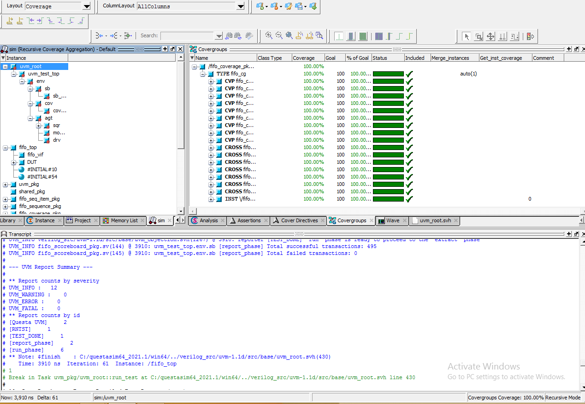

# UVM Verification of a Synchronous FIFO (SystemVerilog)

A complete UVM verification environment for a synchronous FIFO (16-bit data,
depth 8), built with constrained-random sequences, a golden-model scoreboard,
SVA assertions bound to the DUT, and functional coverage. Simulated in QuestaSim.

## DUT
Synchronous FIFO with write/read enables, write acknowledge, and status flags:
full, empty, almostfull, almostempty, overflow, underflow.

## UVM Environment
- **Sequence item:** constrained-random stimulus with weighted wr_en / rd_en distributions
- **Sequences:** reset, write-only, read-only, and simultaneous write/read
- **Agent:** sequencer, driver, and monitor (inputs sampled at posedge, outputs at negedge)
- **Scoreboard:** golden reference model compared against the DUT on every transaction
- **Coverage collector:** covergroups and crosses on wr_en, rd_en, and every flag
- **Top:** interface, DUT, and assertions module attached with `bind`

## Assertions (14 SVA properties)
Flags checked against the internal count (full, empty, almostfull, almostempty),
reset behavior, write acknowledge, full/no-ack, overflow, underflow,
write/read pointer wrap-around, and range checks on count and pointers.
Each assertion has a matching cover directive.

## Results
- Functional coverage: 100%
- Assertions: 14 / 14 passing, zero failures
- Scoreboard: 495 checks passed, 0 failed
- UVM report summary: UVM_ERROR = 0, UVM_FATAL = 0
- Bugs found in the RTL: 10 (see the report in docs/)

## How to Run
1. Open QuestaSim
2. Change directory to `src/`
3. Run: `do run.do`

## Repository Structure
- `src/` → RTL, UVM testbench, assertions, and run.do
- `reports/` → code coverage, functional coverage, and assertion reports
- `docs/` → full verification report and simulation results screenshot

## Documentation
Full report (verification plan, testbench architecture, coverage, assertions,
bugs, and waveforms per sequence):
[docs/UVM_FIFO_Verification_Booklet.pdf](docs/UVM_FIFO_Verification_Booklet.pdf)

## Acknowledgment
This project was completed as part of the Digital Verification using
SystemVerilog and UVM diploma under the supervision of **Eng. Karim Waseem**.

## Author
**Salah Adel**
